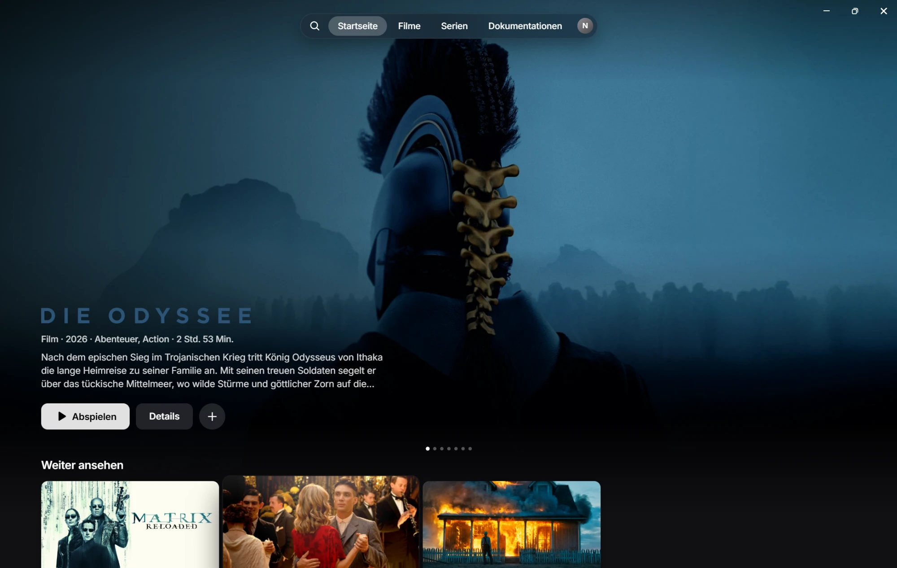
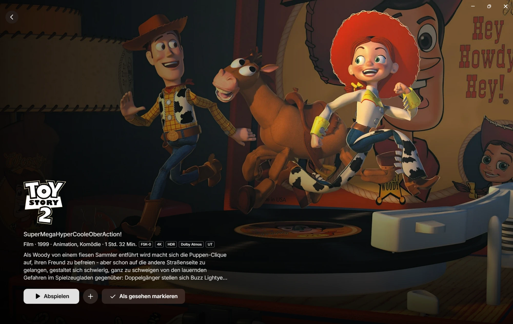
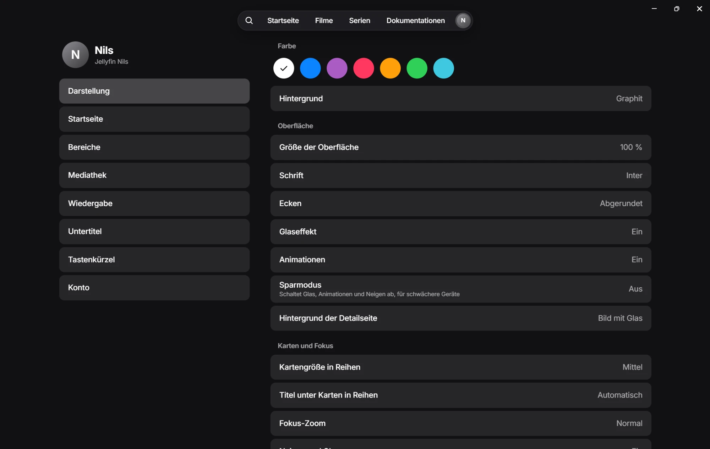

# Cherryfin


Jellyfin client for Windows and LG webOS with an interface in the style of tvOS and the Apple TV app.
Independent project, not affiliated with Apple or the Jellyfin project.

The apps were written entirely by Claude Code.

The interface is available in English and German. It follows the system language and can be changed under **Settings > Appearance > Language**.

## Screenshots







## Download

Ready-made packages are available under [Releases](../../releases/latest):

| File | For |
| --- | --- |
| `Cherryfin.Setup.<version>.exe` | Windows, with installer |
| `Cherryfin-portable-<version>.exe` | Windows, no installation |
| `org.cherryfin.webos_<version>_all.ipk` | LG TVs with webOS 5 or newer, through Developer Mode |

The Windows packages are not signed, so Windows SmartScreen warns on the first start.

## Getting started

This section only applies if you build Cherryfin from source yourself. The packages under [Releases](../../releases/latest) already include mpv.

### Why mpv?

[mpv](https://mpv.io/) is a free video player that Cherryfin uses for playback on Windows. Electron's built-in player (Chromium) cannot play many formats that are common in movie collections. The Jellyfin server then has to convert them live (transcode), which costs server power and often picture quality. mpv, on the other hand, plays practically everything directly:

| | With mpv | Built-in player only |
| --- | --- | --- |
| MKV, HEVC (H.265), AV1 | direct | mostly converted by the server |
| Audio in DTS, TrueHD, E-AC3 | direct | converted by the server |
| Passthrough to an AV receiver (Dolby Atmos, DTS:X) | yes | no |
| Image subtitles (PGS, DVD) | direct | burned into the picture by the server |
| Switching audio tracks | instant | server delivers the title again |

Cherryfin still works without mpv, using the built-in player. You can switch between the two at any time under **Settings > Playback**. On the TV (webOS), the TV's own media player always plays, so mpv is not needed there.

### Setting up mpv

`mpv.exe` is not in the repository, because at over 100 MB it is too large for GitHub. Before the first start, download the build [mpv-x86_64-20261105-git-3138fc8eea](https://github.com/zhongfly/mpv-winbuild/releases) from zhongfly/mpv-winbuild and put `mpv.exe` into `vendor/mpv/`. Cherryfin was tested with exactly this build.

### Build and run

```bash
npm install
npm start
```

On the first start the app searches the network for Jellyfin servers. Without a server, everything can be tried out with **Try the demo**.

## Commands

| Command | Purpose |
| --- | --- |
| `npm start` | Build and start in Electron |
| `npm run dev` | Development with hot reload in Electron |
| `npm run web` | Interface only, in the browser; demo at `http://localhost:5173/?demo=1` |
| `npm test` | Unit tests |
| `npm run dist` | Build the installer and portable `.exe` in `release/<version>/` |

The window tests are described in [tests/README.md](tests/README.md).

## Controls

| Input | Keyboard | Gamepad |
| --- | --- | --- |
| Navigate | Arrow keys | D-pad, left stick |
| Select | Enter | A |
| Back | Esc, Backspace | B |
| Play/pause | Space | Start |
| Skip in the player | Arrow left/right (10 s) | D-pad left/right |
| Full screen | F, F11 | |

With the mouse, the focus follows the pointer and the cards tilt along. The back button at the top left only appears when using the mouse.

## Overview and customization

Every video library on the server becomes its own section in the top bar. If there is no library for documentaries, the section is built from matching genres, if any. By default a section shows all titles from A to Z, with sections and an A–Z bar for jumping.

Almost everything can be adjusted, under **Settings** and with the **View** button in each section:

| Category | Options |
| --- | --- |
| Appearance | Language, accent color, background, interface size, font, corners, glass effect, animations, power saving, detail page background, card size, titles below cards, focus zoom, tilt and shine, focus ring, progress bars, checkmark on watched, spoiler protection |
| Home | Header (rotating, fixed, off), rotation time, content, description, card format, continue watching (together, separate, only one of them), time range for next up, show/hide and reorder rows |
| Sections | Show/hide, reorder, overview or rows, merge libraries |
| Library | Default for all sections: grid or list, portrait or landscape, size, titles, sort order, direction, sections, A–Z bar, header image, unwatched only |
| Playback | Quality for home network and internet separately, next episode automatically, player in full screen, skip lengths, remember audio and subtitle language, incognito, screensaver, picture fit, hardware decoding, buffer, behavior per segment (intro, recap, commercials, preview, credits), speed while holding the mouse button, double-click, media keys, volume at start and all audio settings |
| Subtitles | Size, bold, color, outline, background, distance from the bottom |
| Keyboard shortcuts | Custom keys in the player for mute, volume, speed, subtitles, next episode and skip segment (not on the TV) |

Adjustments made with the **View** button only apply to that section and take priority over the default. All settings are stored locally on this computer and are not synced with the server.

## Playback with the built-in player

The app sends the server a device profile. The server uses it to decide:

- **Direct play** for MP4, MOV and WebM with codecs that Chromium supports. HEVC and AV1 are only reported if the device can play them according to `canPlayType`.
- **HLS** for everything else, such as MKV: repackaged only if possible, otherwise transcoded.
- If direct play still fails, the player switches to HLS automatically.
- Other audio tracks always go through HLS, because Chromium cannot switch tracks in direct play. This can put more load on the server.
- Text subtitles arrive as WebVTT; the server burns in image subtitles (PGS, DVD).

Trickplay previews, “Skip intro” through media segments (from Jellyfin 10.10) and automatic next episodes are supported as well.

## Structure

```text
electron/        Main process, preload, server discovery, encrypted credentials
src/api/         Jellyfin client, device profile, demo data
src/focus/       Focus navigation for keyboard, mouse and gamepad
src/i18n/        Translations (English source texts, German in de.ts)
src/ui/          Cards, rows, hero, icons
src/screens/     Sign-in, home, library, details, search, player
src/styles.css   Design system
```

The access token is stored encrypted in the user profile through Electron `safeStorage` (Windows DPAPI). The password is not stored.

## LG webOS

The TV gets its own build without Electron and mpv:

```bash
npm run package:webos
```

This creates the IPK package, the Homebrew Channel manifest and the icon in `release/webos/`. With `--source` and `--icon`, the script writes the public addresses into the manifest:

```bash
node scripts/package-webos.mjs --source https://github.com/NiIZen/cherryfin --icon https://github.com/NiIZen/cherryfin/releases/latest/download/icon160.png
```

webOS 5 is the minimum (models from 2020, Chromium 68). Differences from the Windows app:

- The TV's media player plays the files, including MKV, HEVC and Dolby. DTS can be turned on if the model supports it; otherwise the server converts the audio.
- Passthrough to a receiver is set up in the TV's sound settings (HDMI ARC or eARC).
- Text input uses an on-screen keyboard. The app does not search for the server itself; the address is entered once.
- The access token is stored unencrypted in this app's storage, because the TV offers no encrypted storage.
- The glass effect is off by default for performance. The top bar stays translucent anyway; only power saving makes it opaque.

The template for the Homebrew Channel entry is in `webos/homebrew-package.yml`. The rules are in [webosbrew/apps-repo](https://github.com/webosbrew/apps-repo): AI-assisted development must be disclosed in the pull request, and a human must have tested and reviewed the app.

## Connection loss

If the server stops responding, a message with **Reload** appears instead of an empty page. The app keeps checking in the background and reloads by itself once the server is back. The sign-in and the position in the app are kept. A running title is not interrupted as long as video is still buffered; if playback stops, the player offers **Reload** there. F5 or Ctrl+R reload at any time.

## Player and audio

By default [mpv](https://mpv.io/) plays the titles. It ships with the app and reads practically every format directly, including MKV, DTS and TrueHD. The server only has to convert when the bitrate is above the configured limit. mpv reads subtitles from the file itself, including PGS and DVD, without burning them in.

The built-in player can be selected under **Settings > Playback**. Demo mode always uses the built-in player.

| Setting | Effect |
| --- | --- |
| Output device | Chooses the Windows audio device, for example the receiver. Windows usually only lists it while it is switched on. |
| Passthrough | Audio goes to the receiver unchanged, switchable per format for AC3, E-AC3, TrueHD, DTS and DTS-HD. Needed for Atmos and DTS:X. |
| Passthrough off | mpv decodes itself and sends uncompressed multichannel audio. Lossless, but without Atmos and DTS:X objects. |
| Exclusive audio mode | mpv uses the device alone. Needed for TrueHD and DTS-HD. Other Windows sounds are muted meanwhile. |

The audio menu in the player shows what is currently output, for example `Passthrough: Dolby TrueHD` or `PCM: 7.1`. In the end, the receiver's display is what counts.

Some audio drivers (proven with Intel Smart Sound) do not start the playback clock of the first audio stream when the device has been silent for a few seconds. The picture then stays on the first frame, with mpv as well as with the built-in player. So before every load, the app opens and closes the device with silence for 0.6 seconds. If the time still stands still with mpv, it restarts the audio output and finally uses exclusive mode. If the device does not accept a format via passthrough, the title plays with PCM and the player says so.

Technically, mpv renders into its own native window, with a transparent window holding the controls on top. The main window is hidden meanwhile. `vendor/mpv` contains the build [zhongfly/mpv-winbuild](https://github.com/zhongfly/mpv-winbuild) (`mpv-x86_64-20261105-git-3138fc8eea`).

## Limitations

- Music, photos, books and live TV are not included.
- The settings are modeled on the source code of Fladder. Downloads, touch gestures, picture-in-picture, Seerr and a subtitle offset were not adopted.
- In windowed mode the player can be moved but not resized. F toggles full screen.
- HDR and Dolby Vision depend on Windows, the graphics card and the display, and are not tested.
- ASS/SSA subtitles are converted to WebVTT and lose their formatting in the built-in player.
- The font is Inter. SF Pro is only used if it is installed locally; it is not included.
- Switching the language reloads the app once. In demo mode this ends the demo.

## License

Cherryfin is licensed under the [GNU General Public License 3.0](LICENSE). The Windows packages include [mpv](https://mpv.io/) (GPL-2.0 or later); the source code of the included build is at [mpv-player/mpv](https://github.com/mpv-player/mpv) at commit `3138fc8eea`, and the build script at [zhongfly/mpv-winbuild](https://github.com/zhongfly/mpv-winbuild).

Jellyfin is a project of the Jellyfin community. Cherryfin is an independent client and not affiliated with it.
